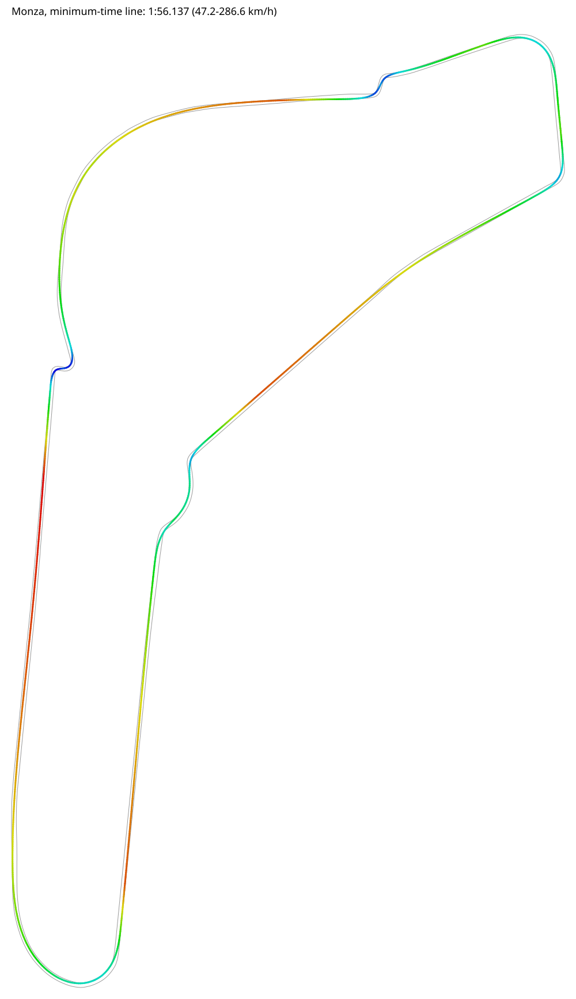
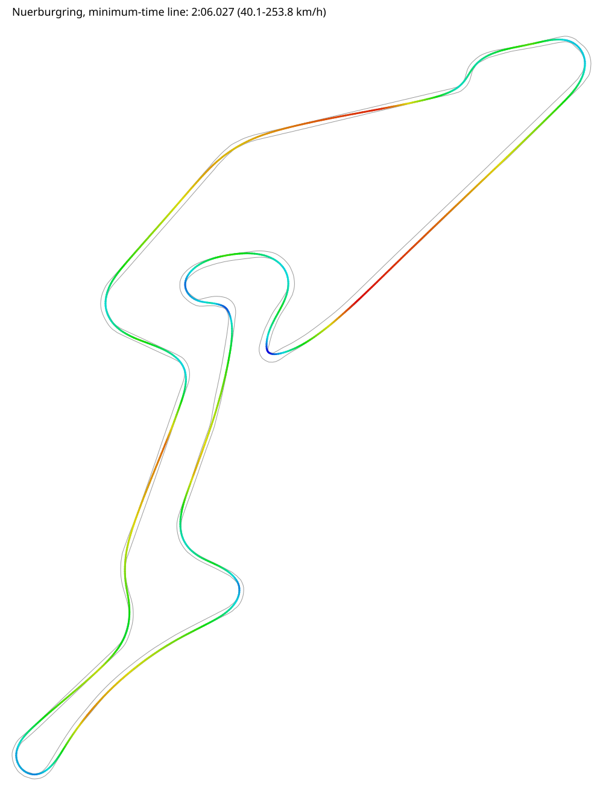

# Apex: Racing Line & Lap-Time Optimiser

A C# / .NET 10 solver that loads a real race track, computes three racing lines (centreline, minimum curvature, minimum lap time), simulates a car around each, and draws the fastest one as a speed-coloured SVG.

Its purpose is depth on CPU-bound performance in .NET (`Parallel.For`, `Span<T>`, SIMD, BenchmarkDotNet) and on the maths behind it (splines, convex optimisation, numerical gradients, dynamic programming, Newton's method).

## Results

Both tracks are resampled to stations 5 m apart and driven by the default car (1,300 kg, 300 kW, 1.3 g grip, no downforce).

| Line | Monza (5,790 m) | Nürburgring GP (5,144 m) |
| --- | --- | --- |
| Centreline | 2:06.547 | 2:22.581 |
| Minimum curvatue | 1:56.636 | 2:06.957 |
| Minimum time | 1:56.137 | 2:06.027 |
| Lattice (dynamic programming) | 2:14.794 | 2:31.867 |

<table>
  <tr>
    <td align="centre"></td>
    <td align="centre"></td>
  </tr>
  <tr>
    <td align="centre">Monza</td>
    <td align="centre">Nürburgring GP</td>
  </tr>
</table>

Minimum-time lines, coloured from blue (slowest) to red (fastest). Grey lines are the track edges.

With a downforce grip model (`--grip`, see below) the Monza minimum-time frops to 1:52.278.

Lap times are deterministic and should match to the millisecond on any machine.

On the Nürburgring the optimised lines have a tighter tightest corner than the centreline (radius 9.7 m against 12.7 m), tey are 16 s faster. The minimum-curvature over the whole lap rather than limitting the peak, so it will accept one tighter apex if that straightens the corners around it.

## Quick start

### Prerequisites

- .NET 10 SDK
- A clone of [MathEngine](#mathengine-location). The `Apex.MathEngine` adapter references it to parse, differentiate, and compile user-typed grip formulas.

### Clone

The simplest setup is to clone both repos into the same parent folder:

```bash
git clone https://github.com/Nduh0976/MathEngine.git
git clone https://github.com/Nduh0976/Apex.git
```

```text
<any folder>/
├── MathEngine/src/MathEngine/MatheEngine.csproj
└── Apex/                                           <- this repo
```

With that layout everything builds with no configuration. If you keep MathEngine somewhere else see [MathEngine location](#mathengine-location).

### Tracks

The repo includes two tracks in `tracks/`: `Monza.csv` and `Nuerburgring.csv`. To add another from the [TUM racetrack database](https://github.com/TUMFTM/racetrack-database), download it into the same folder:

```bash
curl -o tracks/Spa.csv https://raw.githubusercontent.com/TUMFTM/racetrack-database/master/tracks/Spa.csv
```

Any track from that repository loads without code changes. See [Track data](#track-data) for the licence.

### Run

From the repo root

```bash
dotnet run -c Release --project src/Apex.Cli --tracks/Monza.csv
dotnet run -c Release --project src/Apex.Cli --tracks/Nuerburgring.csv
```

Or open `Apex.slnx`, set **Apex.Cli** as the startup project, and press F5. With no track argument app finds `tracks/Monza.csv` by walking up from it's build folder and runs from the repo root, so output lands in the same place either way.

Debug builds are roughly three times slower than Release. Use Release when you care about timings.

### MathEngine location

`src/Apex.MathEngine/Apex.MathEngine.csproj` finds MathEngine through an MSBuild property, `MathEngineProject`. Its default is the side-by-side layout above. To point it somewhere else, use one of these, in order of convenience:

**1. A local props file (recommended).** Create `Directory.Build.local.props` in the Apex repo root:

```
<Project>
  <PropertyGroup>
    <MathEngineProject>C:\path\to\MathEngine\src\MathEngine\MathEngine.csproj</MathEngineProject>
  </PropertyGroup>
</Project>
```

The root `Directory.Build.props` import this file when it exists, so Visual Studio, Rider, and the `dotnet` CLI all pick it up.

**2. An environment variable.** MSBuild reads environment variables as properties, so setting `MathEngineProject` to the full path works for every build in that shell or user profile.

**3. A one-off command-line override.**

```bash
dotnet build -p:MathEngineProject="/path/to/MathEngine/src/MathEngine/MathEngine.csproj"
```

Paths with spaces are fine in all three. If the path is wrong, the build stops with an error naming the path it tried.

## Usage

```text
Apec.Cli [track.csv] [--grip "<formula in v>"] [--lattice] 
```

| Option | Effect |
| --- | --- |
| `track.csv` | Track to load. Defaults to `tracks/Monza.csv` when omitted. |
| `--lattice` | Also run the dynamic-programming solver and report its lap time. |
| `--grip "<formula>"` | Replace the constant-grip model with a formula in speed `v`, parsed, differentiated and compiled by MathEngine. Available constants: `mu`, `g`, `rho`, `cla`, `m`. |

Example with downforce:

```bath
dotnet run -c Release --project src/Apex.Cli -- tracks/Monza.csv --grip "mu * (g + 0.5 * rho * cla * v^2 / m)"
```

Output is a lap-time table on the console nad `out/<Track>.svg`: the minimum-time line coloured from blue (slowest) to red (fastest).

## How it works

1. **Track.** The centreline is resampled to equally spaced stations along a periodic cubic spline. Each station has a unit left-normal and a usable width eather side.
2. **Line.** A racing line is one lateral offset per station, bounded by the track edges minus a 1 m margin. This turns geometry into a vector box constraints.
3. **Lap simulation.** Curvature comes from a periodic cubic spline through the line, solved with a cyclic tridiagonal (Sherman-Morrison) solver. The car is a point mass on a friction ellipse with power and drag limits. Forward and backward passes, seeded at the tightest corner, give the speed profile and the lap time.
4. **Minimum curvature.** A convex quadratic in the offsets, solved by accelerated projected gradient descent (FISTA with adaptive restart), with reweighting to correct for uneven point spacing.
5. **Minimum time.** Projected gradient descent on the lap time itself. It optimises smooth cubic B-spline corrections on top of the minimum-curvature line, with the gradient estimated by central differences in parallel.
6. **Lattice search.** Dynamic programming over fixed lanes on coarse stations. It is globally optimal for a speed-free proxy cost and loses badly on the real lap, which is the lesson it is there to teach.

## Project layout

```text
Apex.slnx
Directory.Build.props           net10.0, nullable, warnings as errors
tracks/                         Monza and Nürburgring CSVs from the TUM racetrack database
out/                            SVG maps written by the CLI (the README shows these)
src/
  Apex/                         core library: no dependencies
    Geometry/                   Vec2, Tridiagonal, SplineMath, PeriodicSpline
    Tracks/                     Tack, TrackLoader, TrackFactory
    Vehicles/                   IGripModel, ConstantGrip, FunctionGrip, CorneringSolver, Vehicle
    Simulation/                 LapSimulator, LapWorkspace, LapResult
    Optimisation/               MinimumCurvature, MinimumTime, LatticeSearch, BSplineBasis, VectorKernels
    Output/                     SvgWriter
  Apex.MathEngine/              adapter: user-typed grip formulas via MathEngine project
  Apex.Cli/                     console app
test/Apex.Tests/                xUnit tests
bench/Apex.Benchmarks/          BenchmarkDotNet benchmarks
```

Dependencies point one way: Geometry <- Tracks <- Vehicles/Simulation <- Optimisation <- Cli. The core library never references MathEngine; the adapter project is the only place that knows both.

## Tests

```bash
dotnet test
```

33 tests, about a second. They rely on answers that do not come from the code under test:

- **Closed forms.** Circle curvature is l/R, and a circular lap time matches perimeter / sqrt(a_y R).
- **Invariants.** Lap time is unchanged by rotating the start point or mirroring the track.
- **Safety properties.** No optimiser ever leaves the track, including for extrem B-spline controls.
- **Regressions.** Comma-decimal cultures, and scalar vs SIMS agreement.
- **One documented limitation.** Minimum curvature hugs the inside of a circle.

## Benchmarks

```bash
dotnet run -c Release --project bench/Apex.Benchmarks -- --filter '*'
```

| Benchmark class | Compares |
| --- | --- |
| `LapSimulationBenchmarks` | Allocating `Simulate` vs reused-workspace `LapTime` (with memory diagnoser) |
| `TridiagonalBenchmarks` | Two cyclic solves vs on paired solve |
| `MinimumCurvatureBenchmarks` | Scalar vs `Vector<double>` kernels |
| `GradientBenchmarks` | Lap-time gradient on 1, 2, 4 and 8 threads |

Record your results with your CPU model; they are the evidence for which optimisations earned their complexity

## Known limitations

- The car is a point mass: no yaw, load transfer or tyre slip angles.
- Minimum time is a local optimiser. It improves on its starting line but proves nothing about global optimality.
- The minimum-curvature objective is biases towards the inside of corners, because second diferences scale with point spacing. Reweighting corrects this between stations but not on a uniform circle (see the documented test).
- The lattice search's cost has no memory of speed, so it favours sharp flicks the real car would have to brake for.

## Track data

The CSV files in `tracks/` come from the [TUM racetrack database](https://github.com/TUMFTM/racetrack-database) by the Institute of Automotive Technology at the Technical University of Munich. That repository is published under the GNU LGPL v3.0, which allows redestribution provided the licence travels with the data. Keep a copy of its `LICENSE` file in `track/` alongside the CSVs.

## Possible extensions

- `--report`: time gained per corner between two lines.
- Structure-of-arrays storage so the curvature gradient vectorises.
- An incremental lap-time gradient that recomputes only the affected window.
- Speed-aware dynamic programming (speed in the state).
- A bicycle model or measured GG-V envelope behind `IGripModel`.